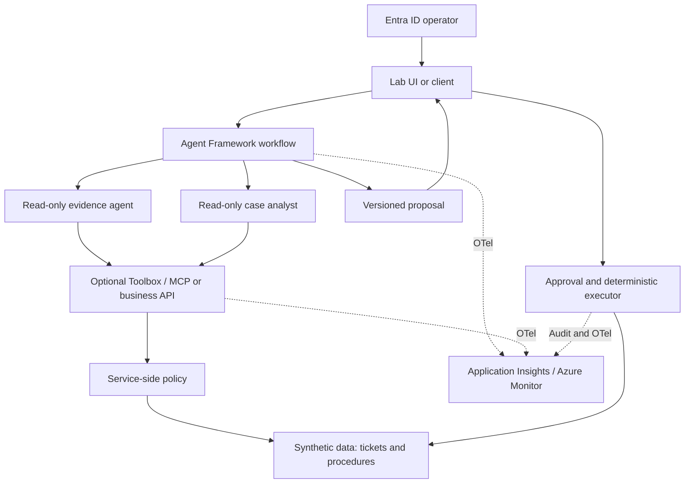

## Current selection status

The user requested more impactful alternatives on 2026-11-02.
The [new demo discovery record](../../.copilot-tracking/discovery/use-case-selection.md)
compares three directions and records the initial selection questions.
The user subsequently selected manufacturing supply-chain discovery for
a mixed audience; see the [project state](../../.copilot-tracking/projects/supply-chain-resilience/state.md).
The specific scenario and architecture are still unapproved.
The original proposal below is retained for reference; it was not approved
and must not be used as the default solution.

## Selection criteria

Lab proposal: choose a use case that demonstrates both success and
correct refusal, with synthetic data, controllable costs, and reversible actions.
Complexity must help measure a control, not multiply agents.

| Candidate use case               | Demonstration value                          | Main limitation                                 |
| -------------------------------- | -------------------------------------------- | ----------------------------------------------- |
| Support case copilot with policy | Retrieval, analysis, data scope, HITL, audit | Requires fixtures and clear ownership policies  |
| Synthetic returns/refunds        | Clear least privilege and approval           | Risk of expanding into a transactional domain   |
| Read-only IT incident analysis   | Telemetry, concurrent analyses, escalation   | Real connectors and environments increase scope |

Initial recommendation: **Support Case Resolution Lab**.
This is not the user's final choice.

## Candidate scenario

An operator opens a synthetic ticket about a software service.
The system retrieves the authorized ticket, searches approved procedures,
analyzes symptoms, and proposes next steps with evidence.
The operator can approve adding a note to the demo ticket.

No remediation commands, infrastructure changes, real emails,
refunds, or production system updates are performed.

## Logical roles and components

| Component                    | Task                                            | Proposed capability                             |
| ---------------------------- | ----------------------------------------------- | ----------------------------------------------- |
| Deterministic workflow       | Sequence, limits, state, and joins              | Routing and validation, not unrestricted writes |
| Evidence agent               | Search procedures and cite versions             | Read-only search of synthetic knowledge         |
| Case analyst agent           | Analyze tickets and propose a plan              | Read the authorized ticket                      |
| Final synthesis              | Produce a structured proposal                   | Function/LLM to justify in the benchmark        |
| Candidate tool service / MCP | Expose business capabilities and enforce policy | Authorized reads, no arbitrary URLs             |
| Approval + executor service  | Validate approval and write a note              | Limited, idempotent, audited writes             |

Two LLM agents are sufficient for the first test. A third LLM synthesis
is introduced only if it improves results over deterministic composition.
An LLM "security agent" does not authorize operations.

## Proposed architecture without APIM

The executor is called through the operator's approved path, not as a
write tool available to the two agents. It must verify on the server
that the operator has approval rights and that the proposal is still
valid. It does not trust the state reported by the UI.

The relationship between executor and data in the diagram does not imply
that business audit is only a sampled trace. A durable operation record
is required, with a transaction/outbox or equivalent strategy to be selected.

## Hosting options to compare

1. Workflow in a Foundry hosted agent; specialists initially in-process.
2. The same workflow in a local/external runtime with Foundry Responses.
3. Prompt agent for the single-agent baseline or for specialists, if useful.

Product capabilities and limitations are described in
[development](../knowledge/development.md). This is not a choice of three
hosting options: compare a vertical slice and retain one primary target.

## Actual security boundaries

In the variant with in-process specialists, the two logical roles do not
automatically have different Entra identities. Least privilege is
demonstrated at the runtime/tool/executor boundary and in data scope,
not claimed per agent without evidence of a distinct principal.

| Proposed principal       | Expected minimum permission                          |
| ------------------------ | ---------------------------------------------------- |
| Operator user            | Read their own cases and request analysis            |
| Authorized approver user | Approve the note within their own scope              |
| Agent runtime            | Inference and invocation of read-only capabilities   |
| Tool service             | Read assigned demo resources/partitions              |
| Executor service         | Write only the specified note type                   |
| Deployment identity      | Manage resources/versions, separate from the runtime |

To demonstrate IAM for each specialist *as well*, an experiment with
distinct runtime agents and separate identities can be added.
This is not mandatory for the first vertical slice.

User scope must reach the server in a verifiable context, through a
supported delegated token or another designed and tested trusted
mechanism. If the chosen path loses that context, the spike fails:
ownership must not be reconstructed from a `user_id` in the prompt.
References: [S09](../research/sources.md#s09),
[S10](../research/sources.md#s10), [S11](../research/sources.md#s11).

## Candidate tools

* `get_case(case_id)`: reads only an authorized ticket.
* `search_policy(query)`: returns synthetic documents with ID and version.
* `get_policy(policy_id)`: retrieves an authorized procedure.

The `append_approved_note` command stays in the executor service, separate
from LLM tools. It receives a proposal and idempotency key, not free-form
text that could differ from what was approved.

A custom MCP server is justified if reused by the single agent and the
workflow, and if testing demonstrates its auth, scope, and tracing.
Otherwise, a typed API is sufficient. Sources for the options:
[S12](../research/sources.md#s12), [S13](../research/sources.md#s13).

## Proposed demo script

1. Authorized ticket: evidence and proposal with verifiable citations.
2. Same request without permissions: refusal before record access.
3. Procedure with a synthetic malicious instruction: no new privileges.
4. Missing document: abstention or clarification, no invented citations.
5. Approved note: a single change, shown in the backend.
6. Replay and timeout: no second note.
7. Drill-down: correlated trace and audit without sensitive content.
8. Single-agent/multi-agent comparison: measured quality, tokens, and latency.

Each step must have an expected outcome and a fixture reset.
The audience must also see the controls that block an action,
not only a well-worded response.

## What remains out of scope

APIM/APIM-dependent AI Gateway, access to real tickets, arbitrary
web browsing, shell, long-term memory on real data, voice,
distributed A2A, and optimizer with automatic promotion.

These are exclusions for the first demo, not claims that these capabilities
are not useful in a different project.
