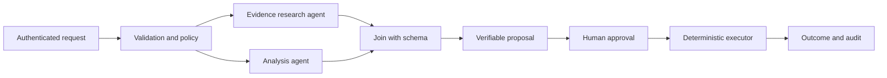

## First verify that multiple agents are needed

Lab proposal: the baseline is a single agent with the same tools
and dataset. A multi-agent solution must demonstrate at least one benefit:
capability isolation, higher measured quality, or greater process
controllability. More calls are not an outcome.

A role in a prompt is not a security boundary. Multiple agent objects
in the same process may share identity and memory: separating them
logically does not automatically create IAM isolation.
The boundary must be in the tool service, the data, or separate
runtimes/identities. Product sources: [S03](../research/sources.md#s03),
[S10](../research/sources.md#s10), [S11](../research/sources.md#s11).

## Documented patterns and trade-offs

| Pattern    | When to consider it                  | Risk that must be shown to be under control  |
| ---------- | ------------------------------------ | -------------------------------------------- |
| Sequential | Steps with verifiable inputs/outputs | Propagated errors and cumulative latency     |
| Concurrent | Independent analyses to aggregate    | Costs, uncontrolled fan-out, and conflicts   |
| Handoff    | Transfer of responsibility           | Loops, context loss, and ambiguous authority |
| Group chat | Discussion between specialists       | Long conversations and unreliable stopping   |
| Magentic   | Dynamic planning with a manager      | Replanning, costs, and variable trajectories |

The names and capabilities come from
[S07](../research/sources.md#s07); the risk assessment is the lab's own.

The framework provides executor graphs, conditions, events, and checkpoints.
Python also has an experimental functional API.
Sources: [S06](../research/sources.md#s06).

## Proposed baseline: controlled workflow

Use concurrency only if research and analysis are independent.
If analysis requires the evidence, the graph becomes sequential. Do not
parallelize a logical dependency to make the design look more sophisticated.

Critical policies and the executor should not be LLMs merely for consistency.
An agent can recommend, but a deterministic function checks
scope, state, preconditions, and approval before any change.

## Proposed contracts between steps

Each step must have:

* A typed schema and contract version
* Evidence with a document ID, version, and verifiable reference
* An explicit status: completed, unauthorized, insufficient data, or error
* Limits on the number and size of results
* A run identifier for correlation, separate from the authorization context

"I don't know" is a valid outcome when supported by missing data.
Do not turn timeouts, denies, or malformed outputs into a plausible answer.

## Proposed execution limits

For the first demo: at most 3 LLM agents, 8 model calls, and 6 tool calls
per run, with only one regeneration for invalid structured output.
These are initial lab values to calibrate, not Foundry limits.

Provide an end-to-end deadline, per-dependency timeouts, cancellation, and
a cost limit. Exceeding a limit ends execution with an explicit status and trace.
Retries are allowed for transient errors, not to bypass a deny.

## State and human-in-the-loop

HITL and tool approval are supported in the framework patterns.
Source: [S07](../research/sources.md#s07).

Proposal: a business approval is a server-side record binding
approver, proposal, version, target, action, expiration, and usage status.
It is not a "yes, proceed" sentence stored only in the prompt.

A workflow checkpoint does not guarantee exactly-once execution on a remote tool.
An idempotency key, a uniqueness constraint on the action, and a state check
before retrying are required. After a timeout with an uncertain outcome, reconcile
with the authoritative system instead of blindly repeating a write.

## When A2A and MCP are needed

MCP integrates capabilities/tools. A2A concerns delegation between agents.
Neither is mandatory for an in-process workflow.
The hosted runtime documents A2A among its protocols, but adding it
requires a contract for identity, authorization, and cross-service failures.
Sources: [S03](../research/sources.md#s03),
[S12](../research/sources.md#s12).

In the first increment, do not deploy every specialist as a separate
service. Separate one only when a real boundary or an IAM test is needed.
